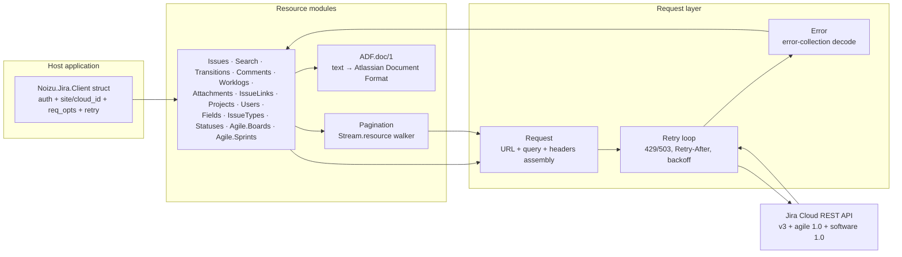

# noizu_jira — Architecture

## Overview

`noizu_jira` is a **stateless API client library** for the Jira Cloud REST API
(platform v3 + Jira Software agile API). There is no application, no
supervisor, no process registry, no config: a `Noizu.Jira.Client` struct is
built once (auth mode + target site/cloud id + retry overrides) and passed
explicitly to every call. All functions are pure request/response: `{:ok,
decoded_json_map}` or `{:error, %Noizu.Jira.Error{}}`.

Design intent is a *thin, contract-first* client: bodies stay decoded maps
(no response structs), and every behavioral rule is pinned in
[`docs/API-CONTRACT.md`](API-CONTRACT.md) — endpoint inventory (§4), query
encoding (§5a), error model (§6), retry policy (§7), and the decision log (§10).

## System Diagram

## Core Components

| Component | Purpose |
|-----------|---------|
| `Noizu.Jira.Client` | Immutable config: auth tuple, site/cloud_id, `req_opts` (forwarded to Req), retry overrides |
| `Noizu.Jira.Request` | Only place HTTP happens: URL/query/header assembly, auth header, 429/503 retry loop, error decode |
| 14 resource modules | One per endpoint family; `(client, ...args, opts)` → `{:ok, body} \| {:error, error}` |
| `Noizu.Jira.Pagination` | Shared `Stream.resource` walker with offset / nextPageToken / array termination strategies |
| `Noizu.Jira.Error` | Exception mirroring Jira's error-collection payload; `reason` for transport failures |
| `Noizu.Jira.ADF` | Plain text → minimal Atlassian Document Format; pass-through for ADF maps |

→ *Components ↔ directories: [PROJ-LAYOUT.md](PROJ-LAYOUT.md); module detail: [layout/lib.md](layout/lib.md)*

## Data Flow

1. Host builds a client (`Client.new/1` — validates auth, normalizes `:site`,
   requires `:cloud_id` for OAuth) and calls a resource function.
2. The resource module wraps plain text in ADF where the API requires it,
   delegates to `Request.request/4` (streams wrap the first call in
   `Pagination.stream/3`).
3. `Request` assembles base URL + percent-encoded path segments + in-house
   query string, injects the `Authorization` header up front, and executes via
   Req (its own retries disabled).
4. 429/503 responses sleep per `Retry-After`/backoff and re-run, bounded;
   2xx returns the decoded map; anything else becomes `%Noizu.Jira.Error{}`.
5. Bodies are returned as-is — the library never casts responses into structs.

→ *See [arch/request-pipeline.md](arch/request-pipeline.md) and [arch/streaming.md](arch/streaming.md) for details*

## Key Decisions

- **Explicit client, zero global state** — deterministic, concurrent-safe,
  trivially testable; no application env to read.
- **Contract-first** — behavior is specified against fetched Atlassian docs
  before implementation; `docs/API-CONTRACT.md` §10 records each choice.
- **Deprecated surface excluded** — legacy `/search` and the offset
  board-issues endpoint are intentionally absent; replacements only.
- **One retry owner** — Req's `retry: false`; the library's bounded 429/503
  loop honors `Retry-After` exactly.
- **Streams raise** — a lazy `Stream` has no error channel; documented
  convention (§5).

## Technology Stack

- Elixir `~> 1.15`; no OTP application tree (`extra_applications: [:logger]` only).
- [Req](https://hex.pm/packages/req) `~> 0.7` — HTTP client (Finch under the
  hood); multipart streaming powers attachment uploads.
- Jason `~> 1.4` — JSON. Plug `~> 1.16` (test only) + ExDoc `~> 0.34` (dev only).
- Tests: `Req.Test` stubs, offline, fake credentials.

## Security Posture

Credentials live only in the client struct and are placed on outbound
`Authorization` headers; the library reads no env vars or config files
itself. Threat analysis, including site/cloud_id handling and logging
exposure: [THREAT-MODEL.md](THREAT-MODEL.md).
