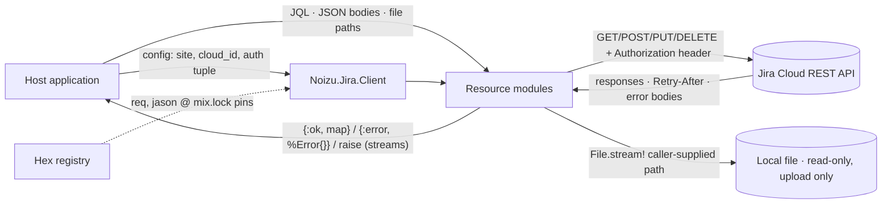

# noizu_jira — Threat Model

## Overview

`noizu_jira` is a **client library**, not a service: it has no listening
ports, no stored data, and no background processes. Its crown jewels are the
**Jira credentials** (API token / OAuth bearer token) held in the caller's
`Noizu.Jira.Client` struct, and the **Jira data** those credentials can
reach. Everything else follows from two boundaries:

1. **Host application ↔ library** — the host is fully trusted; it supplies
   credentials, config values (`site`, `cloud_id`), JQL, JSON bodies, and
   file paths. The library treats these as trusted-but-unvalidated input:
   mistakes or hostile values *within the host's own configuration* are in
   scope for this model (a multi-tenant app passing user-chosen config is
   the realistic threat).
2. **Library ↔ Atlassian Cloud (TLS)** — Atlassian is a semi-trusted
   external service: it controls response bodies and headers (`Retry-After`)
   and can return hostile payloads (giant attachments, error bodies, mangled
   paging envelopes). A network attacker is confined to breaking TLS
   (certificates are verified; scheme is always `https`), i.e. availability
   attacks only.

Supply chain: the Hex registry and the dependency tree (`threats/supply-chain.md`).

## Attack Surface

- **Egress:** exactly one destination per client — `https://<site>` (basic)
  or `https://api.atlassian.com/ex/jira/<cloudId>` (OAuth). One filesystem
  read path: streamed attachment upload.
- **Ingress of untrusted data:** response bodies, response headers
  (`Retry-After` only is acted on), error payloads.
- **No logging, no persistence, no eval:** the library writes nothing, logs
  nothing, and never evaluates response content as code.

## Vulnerability Register

| ID | Severity | STRIDE | Component | Status |
|----|----------|--------|-----------|--------|
| T-001 | High | Information disclosure | `inspect/1` of `Client` prints credentials (verified) | **Open** |
| T-002 | Medium | Information disclosure | `ArgumentError` interpolates `inspect/1` of malformed auth tuple | **Open** |
| T-003 | Medium | Information disclosure / Spoofing | `:site` accepts any host (`@` userinfo trick included) → credentials forwarded to attacker host | **Open** |
| T-004 | Low | Tampering | `:cloud_id` unvalidated in URL string (host fixed, path/query confusion only) | Partial |
| T-005 | Low | Denial of service | `Retry-After` unclamped: negative crashes caller, huge hangs it (verified) | **Open** |
| T-006 | Low | Tampering | Multipart filename unsanitized in `Content-Disposition` | Open (documented) |
| T-007 | Low | Denial of service | `Attachments.content/3` loads whole attachment into memory | Open (documented) |
| T-008 | Low | Information disclosure | JQL logic injection (bounded by token's own permissions; API has no parameterization) | Accepted |
| T-009 | Low | Information disclosure | `%Error{}` retains full response body (host must redact before logging) | Accepted |
| T-010 | Medium | Supply chain | Hex dependency compromise; lockfile-only defense, no CI audits yet | Partial |
| T-011 | High | Spoofing / Information disclosure | TLS interception, downgrade, credential replay | **Mitigated** (https enforced, TLS verified, no cross-host replay) |
| T-012 | Medium | Tampering | Path traversal via ids/keys in URL paths | **Mitigated** (`encode_segment/1`) |

→ *Details: [threats/credentials.md](threats/credentials.md) · [threats/url-construction.md](threats/url-construction.md) · [threats/input-surfaces.md](threats/input-surfaces.md) · [threats/network-retry.md](threats/network-retry.md) · [threats/supply-chain.md](threats/supply-chain.md)*

## Mitigation Coverage

**2 mitigated · 2 partial · 6 open · 2 accepted.**

Already in place (controls, mapped to IDs):

- HTTPS always; scheme re-applied, never caller-chosen (T-003 downgrade leg,
  T-011).
- Standard TLS verification via Req/Finch/Mint; no cross-host Authorization
  replay (T-011).
- Path segments percent-encoded through `encode_segment/1` (T-012); query
  strings built in-house and percent-encoded (parameter-splitting control).
- Single bounded retry owner; transport errors never retried (T-005
  amplification leg).
- No logging, no persistence, no eval of server data; responses stay plain
  maps (T-009 severity, general).
- Lockfile-pinned minimal dependency tree (T-010).

Open items need code (T-001, T-002, T-003, T-005) or documentation
(T-006, T-007); T-004 and T-010 want cheap hardening (UUID check; CI audits).

## Residual Risk

- **Host-side credential handling** — storage, rotation, OAuth refresh, and
  *not logging the client struct* are host responsibilities by design
  (contract §9). The library cannot make `inspect` safe for a struct it
  doesn't control... it can: T-001 is the fix; until then this is the top
  open risk.
- **JQL expressiveness** (T-008) accepted: no parameterized alternative
  exists; blast radius equals the credential's permission scope.
- **Hostile Atlassian responses** — bounded by Jason-decode-only handling
  and bounded retries; the memory-unbounded attachment download (T-007) is
  documented behavior.
- **Registry compromise** (T-010) — standard Hex posture; checksum pins
  limit it to the registry trust root itself.

## Method Note

Findings verified against the code, not assumed: T-001/T-005 behaviors were
reproduced on the VM; every claim about controls traces to
`lib/noizu/jira/{client,request,pagination,error,attachments,search}.ex`.
No git history yet (pre-initial-commit) — this model reflects the working
tree as of 2026-10-17.
